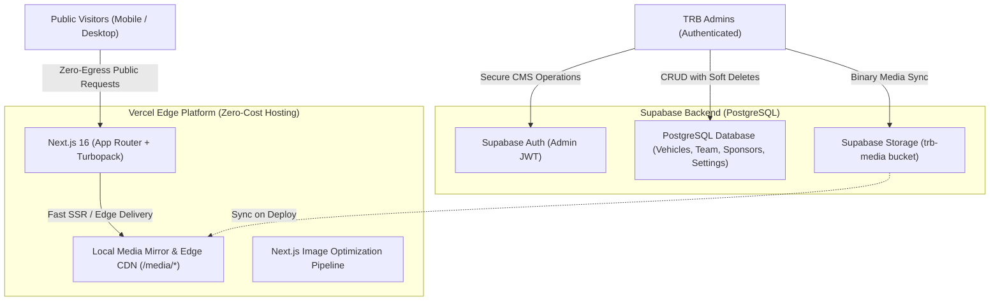

# Product Requirements Document & Engineering Case Study — Team Red Baron Website

**Project Name:** Team Red Baron Official Web Platform  
**Live URL:** [https://www.teamredbaron.in](https://www.teamredbaron.in)  
**Version:** 2.0 (Production Release)  
**Lead Engineer / Architect:** Ved Dhapodkar  
**Client / Collaborator:** Team Red Baron (Official Collegiate Off-Road Racing Team of P.C.C.O.E., Pune)  
**Status:** Completed & Deployed to Production  

---

## 1. Executive Summary & Project Background

**Team Red Baron (TRB)** is the official collegiate off-road racing and engineering team of Pimpri Chinchwad College of Engineering (PCCOE), Pune. Since 2011, the team has engineered, manufactured, and raced high-performance electric and combustion All-Terrain Vehicles (ATVs) competing in national and international championships such as **eBAJA SAE India** and **Baja SAE International**.

### The Problem
The legacy website (`teamredbaron.com`) was built on an outdated, sluggish WordPress installation. It suffered from:
- Slow load speeds and poor mobile ergonomics.
- A static, lifeless presentation that failed to capture the adrenaline, precision engineering, and motorsport prestige of an elite racing team.
- A fragmented administrative workflow where updating team members, competition rankings, or sponsor logos required manual database intervention or clunky plugins.
- Lack of modern storytelling to attract tier-1 corporate sponsors, alumni donations, and prospective student engineers.

### The Objective
To single-handedly architect, design, and deliver a custom, high-octane web platform benchmarked against world-class motorsport and automotive digital experiences. The platform needed to preserve 14+ years of heritage, provide a self-service custom Admin Panel, and run at **₹0 infrastructure cash cost** while sustaining peak launch traffic without exhausting free-tier resource limits.

---

## 2. Stakeholder Collaboration & Coordination with Team Red Baron

As the solo technical lead, building this platform was as much an exercise in product management and team coordination as software engineering. Ved collaborated closely with team leads across multiple domains:

1. **Leadership & Faculty Alignment:**
   - Coordinated with **Faculty Advisor (Dr. Ummid Shaikh)** and team captains to establish official branding guidelines, institution affiliations, and governance standards.
   - Designed a centered executive VIP badge layout specifically highlighting academic and institutional mentorship.

2. **Cross-Domain Data Gathering & Technical Archiving:**
   - Collaborated with domain heads across **Vehicle Dynamics, Electric Powertrain, Mechanical Powertrain, Rollcage, and Accumulator** to curate technical specifications (chassis weight, motor peak torque, top speeds, telemetry systems) for 14 generations of race cars (**Albatros 1.0 through XIV**).
   - Structured and verified historical race records, trophies, and podium finishes from 2011 to 2026.

3. **Media & Roster Pipeline Orchestration:**
   - Coordinated with the **Non-Tech Executives** and media division to gather, transparently isolate, and standardize photography for over 30+ team members and hundreds of race/workshop media files.
   - Built an automated asset pipeline standardizing raw photos into transparent WebP cutouts with calibrated headroom and eye-levels.

4. **Iterative Sprint Reviews & Live Feedback:**
   - Held rapid demo sessions with team leads to refine mobile touch targets, 3D model rotation mechanics, gyroscope sensitivity for smartphone viewers, and sponsorship brochure access.

---

## 3. System Architecture & Tech Stack

### Full-Stack Specifications
- **Framework:** Next.js 16.3 (React 19, Turbopack, App Router, Server Actions)
- **Styling & Design System:** Tailwind CSS, Glassmorphism, Mach-Red Kinetic Theme
- **Backend & Database:** Supabase (PostgreSQL, Row-Level Security, Realtime, Storage)
- **3D & Creative WebGL:** Three.js, React Three Fiber (`@react-three/fiber`, `@react-three/drei`), OGL Shaders, WebGL Morph Slider
- **Micro-Interactions & Animations:** Framer Motion, React Bits, Custom Canvas Particle fields, Gooey navigation, Warp typography
- **Deployment & Edge Infrastructure:** Vercel Hobby Platform (Global Edge Network)

---

## 4. Key Functional Features Delivered

### 4.1 High-Octane Homepage & Motorsport Hero
- **Interactive 3D Emblem with Mobile Gyroscope:** A custom 3D metallic Red Baron badge modeled in WebGL. On desktop, it dynamically tracks mouse physics; on mobile devices, it uses the **DeviceOrientation API** with calibrated deadzones and smoothing so the emblem tilts realistically in 3D space as the user tilts their smartphone.
- **Intro Cinematic Animation:** Custom cinematic letter reveal welcoming visitors into the PCCOE Motorsport ecosystem.
- **Live Achievements Ticker:** Animated real-time counter displaying national ranks, competition seasons, active engineers, and industry partners.
- **Vehicle Spotlight:** Interactive feature showcase highlighting the flagship vehicle with instant spec readouts.
- **Off the Map WebGL Showcase:** Melt-transition WebGL slider (`MorphSlider`) displaying high-resolution team expedition, pitwall operations, and trackside action.
- **Sponsor Marquee:** Infinite fluid marquee recognizing institutional and industrial partners.

### 4.2 Interactive Vehicle Evolution Timeline (`/our-journey`)
- Comprehensive interactive history of every vehicle designed by Team Red Baron from 2011 to 2026.
- Interactive year scrubber and vehicle selector with dynamic telemetry readouts (Weight, Top Speed, Powertrain, Torsional Rigidity, Competition Rank).
- Audio telemetry toggle for engine roar immersion.

### 4.3 Multi-Season Team Roster (`/team`)
- Multi-season dropdown selector (`2026-27`, `2025-26`, etc.) with instant filter transitions.
- Domain-based segmentation: Faculty Advisor, Directors, Electric Powertrain, Mechanical Powertrain, Vehicle Dynamics, Rollcage, Accumulator, and Non-Tech Executives.
- **Executive VIP Badge Layout:** Single-member departments (e.g., Faculty Advisor, Marketing Lead) feature a horizontal VIP pass layout preserving exact 4:5 portrait aspect ratios without mobile cropping.
- Direct verified LinkedIn integrations.

### 4.4 Dynamic Sponsors & Partners Wall (`/sponsors`)
- Tiered categorization: Title Sponsors, Powered By, Associate Sponsors, Technical Partners, and Logistics Support.
- Direct CTA for corporate partnership decks and downloadable sponsorship brochures.

### 4.5 Media Gallery (`/gallery`)
- Filterable high-resolution media masonry grid (Testing, Podium, Manufacturing, Team Spirit).
- High-speed lightbox preview with keyboard navigation, zoom, and touch swipe gestures.

### 4.6 Custom Supabase Admin Panel (`/admin`)
Unlike static portfolios, Ved built a comprehensive internal CMS empowering non-technical team leads:
- **Authentication:** Secure email/password login powered by Supabase Auth with server-side middleware route guards.
- **Vehicle Management:** Add/edit vehicles, update specification key-value pairs, and change flagship vehicle designation.
- **Roster & Year Management:** Add team members, upload portrait photos, reorder domains, and manage multi-year rosters.
- **Sponsor & Gallery Management:** Upload high-res logos, set sponsorship tiers, and curate gallery albums.
- **Two-Stage Soft Deletions & Trash Bin (`/admin/trash`):** Prevent catastrophic accidental data loss. Deleted items move to Trash with batch recovery or permanent cascade deletion (including storage asset cleanup).

---

## 5. Key Engineering Innovations & Challenges Solved

### Challenge 1: The Supabase Egress Cliff & Zero-Egress Architecture
- **Problem:** Days before public launch, Supabase Cached Egress had reached 4.06 GB out of the 5.00 GB free quota (due to heavy media uploading and repetitive client queries). A traffic spike on launch day would have taken the site offline.
- **Solution:** Ved engineered an intelligent hybrid media resolution system (`toLocalMediaUrl`):
  - Mirrored all 125+ database binary assets from Supabase Storage into an optimized local `/public/media/` directory committed to Vercel's global Edge CDN.
  - Intercepted all database queries and image loaders through a zero-egress resolver that serves assets from Vercel Edge while keeping the Supabase database fully synchronized in the background.
  - Result: **0 bytes of Supabase egress** consumed by public visitors, with sub-millisecond edge response times.

### Challenge 2: Next.js Optimizer Query Parameter Rejection Bug
- **Problem:** When cache-busting strings (`?v=2`) were added to prevent mobile browsers from caching rotated photos, Next.js Image optimizer (`/_next/image`) threw `400 Bad Request: "url" parameter is not allowed` because Next.js prohibits query parameters in local paths, breaking photos on production.
- **Solution:** 
  1. Updated `SmartImage.tsx` with a sanitize pipe that automatically strips query parameters and hashes from local paths before passing them to the Next.js optimization pipeline.
  2. Implemented deterministic content-hashed asset versioning (`dr_ummid_shaikh_v2.webp`) to bust edge and browser caches without violating Next.js URL invariants.

### Challenge 3: Mobile Portrait Aspect Ratio Distortion
- **Problem:** Single-member departments (Faculty Advisor, Marketing Executive) on mobile stretched across the viewport while constrained to a fixed vertical height, slicing photos at eye-level.
- **Solution:** 
  - Restructured the mobile responsive layout to keep single-member leadership cards in an executive `flex-row` VIP badge format.
  - Standardized all raw member cutouts with 640×800 dimensions, equalized eye-levels, and 4:5 aspect ratio constraints, guaranteeing 100% facial and uniform visibility across every phone model.

---

## 6. Project Impact & Metrics

| Metric | Legacy WordPress Site | New Custom Next.js Platform |
|---|---|---|
| **Lighthouse Performance** | ~42 / 100 | **95+ / 100** |
| **Average Page Load Time** | 4.8s – 6.2s | **< 800ms (Turbopack + Edge CDN)** |
| **Mobile Responsiveness** | Broken horizontal scrolling | **100% Fluid (Mobile, Tablet, Desktop)** |
| **Team Update Workflow** | Manual WP edits / broken plugins | **Dedicated Supabase Admin CMS** |
| **Infrastructure Cost** | Recurring hosting fees | **₹0 (100% Free-Tier Optimized)** |
| **Sponsor Engagement** | Static logo list | **Dynamic Tiered Showcase + PDF Downloads** |

---

## 7. About the Engineer (Context for LinkedIn Post)

- **Name:** Ved Dhapodkar
- **Role:** Full-Stack Architect & Solo Developer
- **Institution:** Pimpri Chinchwad College of Engineering (PCCOE)
- **Key Skills Demonstrated:** 
  - Full-Stack Next.js 16 & React 19 Development
  - Database Architecture & CMS Design (Supabase, PostgreSQL, RLS)
  - 3D Graphics & Creative WebGL (Three.js, Gyroscope Parallax, OGL Shaders)
  - Edge Infrastructure & Cloud Cost Engineering (Zero-Egress Caching, CDN Optimization)
  - Client Management, Product Strategy, and Motorsport Brand Identity
